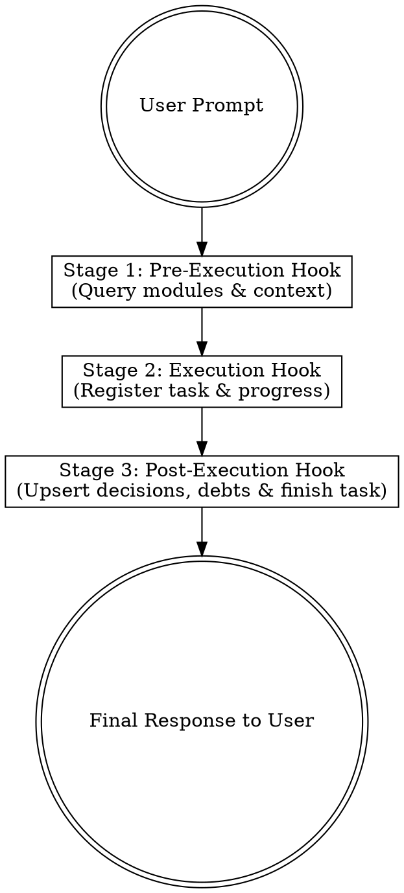

# Managing System Context

## Overview

A structured, database-backed knowledge and task persistence system for AI agents. It ensures persistent memory across sessions, eliminates monolithic documentation bloat, and enforces strict token-efficient context retrieval (concise English summaries <= 250 characters per item).

## When to Use

- At the **very start of every prompt** or task before answering, investigating, or writing code.
- When working on new projects (greenfield) to log requirements, domain models, and architecture decisions.
- When working on existing codebases (brownfield) to scan, partition, and retrieve module architecture, current behaviors, and technical debt.
- At the **end of every task** to update task progress (`01/25`), log new decisions/debts, and close active tasks.

## On-Screen Step Announcements

Every stage MUST be announced to the user in plain text **before** its command runs, using exactly these labels so the user can follow the protocol on screen:

| Stage | Label to print | When |
|---|---|---|
| 1 | `Etapa 1/3 · Contexto` | before `query` |
| 2 | `Etapa 2/3 · Tarefa` | with hooks: mention the task id the prompt hook opened; without hooks: before `task-start`; on `task-step` print the step text |
| 3 | `Etapa 3/3 · Encerramento` | before `upsert` (and, without hooks, `task-finish`) |

Example: `Etapa 2/3 · Tarefa — TASK-M3K9... aberta pelo hook (módulo louza_fe)`. The Claude Code hooks (see below) echo the same labels as system messages, so the two views stay aligned.

**Subagents stay outside the protocol.** They do not run `context-cli`; the coordinating agent passes them the context they need in the prompt and records what they found. The edit guard lets subagents through (their hook input carries `agent_id`).

## Target Selection (`--project`)

- Always pass `--project <id>`. The knowledge base holds one row set per project (`louza`, `qlave`, `qoincamera`, `qoinpass`, `qoinmsg`, `qoinpay`, `qpoker`, `qoinstore`, `qoinsite`, `qoinmodel`, `qoinreviews`, `projetos`); the default is the working-directory basename, which is usually wrong from a sub-folder.
- **The CLI talks to the shared API by default** — `https://api.takius.com.br/v1/context`, PostgreSQL `agent_context` on the Takius server. No `--api-url` needed; set `CONTEXT_API_TOKEN` (the API answers 401 without it).
- `.agents/context.db` is now only a **read-only cache**, refreshed by `context-cli.mjs pull`. When the API is down, reads fall back to it with a warning on stderr and **writes fail loudly** — that is deliberate: writing locally would fork the shared memory in silence. `--no-api` forces the local file for both, and is an explicit offline decision, not a workaround for an outage.

## Enforcement via Claude Code Hooks

`scripts/hooks/` ships four zero-dependency hooks, installed in the **user** settings (`~/.claude/settings.json`) with absolute paths by `scripts/install-hooks.mjs`, so every Claude Code session on the machine runs them, in any folder. A session whose folder has no `.agents/skills/managing-system-context` above it (Temp, scratch folders, smoke tests) is outside every project: the hooks do nothing there and only the universal rules in `~/.claude/CLAUDE.md` apply. When `CONTEXT_API_TOKEN` is not in the environment (a session opened straight in `<root>/louza` does not load `<root>/.claude/settings.local.json`), the hooks read it from that file.

| Hook | Event | Effect |
|---|---|---|
| `on-session-start.mjs` | `SessionStart` (startup, resume, clear, compact) | Injects once per session (and again after compaction): **the whole protocol** (stages are not narrated: the hooks show them on screen), module list, tasks in progress in other sessions (48 h), blocked tasks, the latest results, knowledge items still `in_progress`, and the `search` command. Refreshes the universal rules files in the background (`sync-rules`, at most every 10 min) |
| `on-prompt.mjs` | `UserPromptSubmit` | Detects the project from `cwd`, runs `list-modules` (API, then local) and **opens the task itself** (`task-start`, module guessed from the prompt, `general` otherwise) in parallel; a task still open from an interrupted turn is continued with `task-step`, one older than 6 h is closed as `BLOCKED`. **Searches the base with the prompt's words** (no stop words) and injects the best hits, so the agent rarely spends a turn on `query`. With the session context in place it injects only the task line and the hits; without it, also the module list and the whole protocol |
| `on-edit-guard.mjs` | `PreToolUse` on `Edit\|Write\|NotebookEdit` | Main agent only. The first edit of each turn carries the `upsert` reminder; with no task open (work resumed after the turn closed) it opens one instead of denying. **Denies** only when the API is unreachable. Subagents and files under `.agents/`, `.claude/` and `CLAUDE.md` pass straight through |
| `on-stop.mjs` | `Stop` | **Closes the open task (`DONE`) by itself** (a task the agent closed by hand, e.g. `BLOCKED`, keeps its status; it reads the turn's CLI calls and upserts from the transcript, so no hook runs after every shell command), saves the first lines of the final answer as its result (`current_step` = `resultado: ...`, read by the next session start) and shows how many items the turn saved. Never blocks the turn; if the API is down the task stays open and the next prompt continues it |

Session state lives in `<tmpdir>/claude-context-hooks/<session_id>.json` (written atomically); the last module list per project is cached next to it as `modules-<project>.json`. Edits made through shell commands (`sed`, heredocs) skip the edit guard, which only matters for the reminder: the task is already open.

Short acknowledgements (`ok`, `sim, pode`, `valeu`) open no task and search nothing; if the turn ends up using tools, the Stop hook opens, records and closes its task then. The session-start hook also refreshes the local read-only cache (`pull`) at most once a week, in the background, so reads during an API outage are never older than a week. `upsert` names the items saved without Portuguese `keywords` (answer field `sem_keywords` and stderr).

When the session-start hook ran, the prompt hook no longer repeats the module list (nor calls `list-modules`).

Record knowledge in **one call**: `context-cli upsert --project <p> --file -` reads a JSON array of `{id, module, feature, type, phase, progress?, summary, details?}` from stdin.

## Universal Agent Rules (`sync-rules`)

Rules that every agent follows in every project and folder live in the knowledge base itself: project `global`, module `rules`, one record per rule (`feature` = category, `summary` = the rule, English, max 250 chars; `--phase deprioritized` retires one). `scripts/sync-rules.mjs` renders them, with the protocol templates in `rules/`, into each agent's instruction file, inside a marked block (text outside the block is kept):

| File | Content |
|---|---|
| `~/.claude/CLAUDE.md` | rules (Claude Code in any folder) |
| `~/.codex/AGENTS.md`, `~/.gemini/GEMINI.md` (when the folder exists) | rules + protocol without hooks (`rules/protocol-manual.md`) |
| `<root>/CLAUDE.md` | protocol with hooks (`rules/protocol-hooks.md`) |
| `<root>/AGENTS.md` | rules + protocol without hooks (any tool that reads `AGENTS.md`) |

`<root>` is the folder holding `.agents/skills/managing-system-context`; in the cloud (`~/.agents`) there is none. A file that still holds a hand-written copy of the protocol is replaced whole after a `.bak-<date>` backup. The session-start hook keeps the files fresh; run it by hand after editing a rule:

```bash
node .agents/skills/managing-system-context/scripts/context-cli.mjs upsert --project global --module rules --id RULE-X --feature git --type architecture_decision --phase implemented --summary "<rule>"
node .agents/skills/managing-system-context/scripts/sync-rules.mjs        # --dry-run shows what would change
```

## Install on a Workstation

```bash
# hooks in ~/.claude/settings.json; drops the old project-level entries so nothing runs twice
node <root>/.agents/skills/managing-system-context/scripts/install-hooks.mjs --project-settings <root>/.claude/settings.json
# universal rules and protocol files
node <root>/.agents/skills/managing-system-context/scripts/sync-rules.mjs
```

The cloud setup (`cloud/install.mjs`) does the same inside a Claude Code on the web VM.

## Memory: One Place per Kind of Fact

- **Project facts** (decisions, behaviors, gotchas, status, debts) live in the shared base, which every agent on every machine reads. Do not write them to the Claude Code auto-memory.
- **How agents must work** lives in the universal rules (project `global`, module `rules`).
- **The auto-memory** keeps only pointers (servers, URLs, accounts) and the user's personal notes. On 2026-10-15 its 196 project facts moved to the base as `MEM-*` records (project `projetos`, full note in `details`).

## Weekly Hygiene (`hygiene.mjs`)

`scripts/hygiene.mjs` reads the whole base and reports knowledge `in_progress` untouched for 30+ days, tasks open for 7+ days, summaries not in English, near-duplicate summaries in a project, project facts written to a memory folder, and rules files that differ from the base. `--fix` closes the week-old tasks as `BLOCKED`; `--save` stores the report as `HYGIENE-REPORT` (project `global`, module `hygiene`). The session-start hook runs it with `--fix --save` in the background once a week and shows the summary while the report has findings. Fixing duplicates and summaries is an agent's job: `get HYGIENE-REPORT --project global` lists them.

## The Three-Stage Agent Protocol

Every interaction MUST execute the three stages in order:



---

### Stage 1: Pre-Execution Hook (Context Loading)

Before writing any code or answering complex architecture queries:

1. **List Modules**:
   ```bash
   node .agents/skills/managing-system-context/scripts/context-cli.mjs list-modules
   ```
   *Consumes ~30 tokens. Returns existing modules and item counts.*

2. **If database is empty:**
   - **For existing projects (brownfield)**: Run initial discovery scan:
     ```bash
     node .agents/skills/managing-system-context/scripts/bootstrap-scan.mjs --import --db-path .agents/context.db
     ```
   - **For new projects (greenfield)**: Initialize database and record user requirements:
     ```bash
     node .agents/skills/managing-system-context/scripts/context-cli.mjs init
     ```

3. **Query Relevant Module**:
   ```bash
   node .agents/skills/managing-system-context/scripts/context-cli.mjs query --module <module_name>
   ```
   *Returns concise English summaries (max 250 chars) of architecture decisions, current behavior, and technical debt.*

4. **In Doubt, Search Before Asking**:
   ```bash
   node .agents/skills/managing-system-context/scripts/context-cli.mjs search <words> --project <p>   # this project + global
   node .agents/skills/managing-system-context/scripts/context-cli.mjs search <words> --all           # every project
   ```
   *Case- and accent-insensitive; ranks by words found, then where (summary or id > module or feature > details); also returns matching tasks. Summaries are English, so search with English keywords (Portuguese still finds details and task descriptions).*

5. **On-Demand Deep Dive (Only if necessary)**:
   If a specific record requires full design specifications or code snippets:
   ```bash
   node .agents/skills/managing-system-context/scripts/context-cli.mjs get <ID>
   ```

---

### Stage 2: Execution Hook (Task Tracking)

With the Claude Code hooks installed the prompt hook has already opened the task and injected its id: do not run `task-start`. The steps below are for agents without hooks (Codex, other tools).

1. **Start the Active Task**:
   ```bash
   node .agents/skills/managing-system-context/scripts/context-cli.mjs task-start --module <module_name> --desc "<brief user request>"
   ```
   *Returns the generated `id` (e.g. `TASK-M3K9...`).*

2. **Update Steps During Complex Operations**:
   ```bash
   node .agents/skills/managing-system-context/scripts/context-cli.mjs task-step --id <TASK_ID> --step "Created database schema and migration"
   ```

---

### Stage 3: Post-Execution Hook (Persistence & Closure)

Before delivering your final response to the user:

1. **Record New Architecture Decisions or Technical Debt**:
   If your implementation introduced or identified architecture choices, schema changes, or debt:
   ```bash
   node .agents/skills/managing-system-context/scripts/context-cli.mjs upsert \
     --id "AUTH-DEC-002" \
     --module "auth" \
     --feature "oauth2" \
     --type "architecture_decision" \
     --phase "in_progress" \
     --progress "02/10" \
     --summary "OAuth2 Google provider integration using PKCE flow." \
     --details "Full implementation details and redirect URI config."
   ```

2. **Mark Task Finished** (without hooks; with hooks the Stop hook closes it as `DONE`, so run it only to record `--status BLOCKED`):
   ```bash
   node .agents/skills/managing-system-context/scripts/context-cli.mjs task-finish --id <TASK_ID> --status DONE
   ```

---

## Data Model & Constraints

### Summary Field Constraints
- **Language**: MUST be in **English** (consumes fewer tokens).
- **Length**: Maximum of **250 characters**. The CLI will strictly reject any input exceeding 250 characters. Keep it brief, factual, and actionable.

### Valid Enum Values

| Field | Permitted Values |
|---|---|
| `knowledge_type` | `architecture_decision`, `system_model`, `current_behavior`, `future_revision`, `technical_debt` |
| `phase` | `implemented`, `in_progress`, `queued`, `deprioritized` |
| `tasks_progress` | `XX/YY` (e.g. `01/25`) — required when `phase = in_progress` |
| `status` (tasks) | `PLANNED`, `IN_PROGRESS`, `DONE`, `BLOCKED` |

---

## Database Configuration

The backend is abstracted by `context-cli.mjs`. Since 2026-09-18 the source of truth is remote:

1. **Shared API (default)** — `https://api.takius.com.br/v1/context`, served by the `context_api` Swarm
   stack on the Takius server against the PostgreSQL database `agent_context`. Every agent on any
   machine reads and writes the same rows. Requires `CONTEXT_API_TOKEN`; override the URL with
   `CONTEXT_API_URL` or `--api-url`. Source lives in `context-api/` (server, Dockerfile, stack.yml).

2. **Local cache** — `.agents/context.db` (native `node:sqlite`, Node >= 22). Refresh it with
   `context-cli.mjs pull`; it serves reads while the API is unreachable. Relocate with `--db-path` or
   `CONTEXT_DB_PATH`. Both default to the current working directory, so from another folder the CLI
   would silently address an empty file — always be explicit.

3. **Offline (`--no-api`)** — reads *and* writes the local file. Only for deliberate offline work:
   whatever is written there never reaches the other agents until someone merges it by hand.

---

## Rationalization Table

| Rationalization | Reality |
|---|---|
| "The task is simple, I don't need to load context." | Simple tasks frequently violate unwritten architecture constraints. Always query the module. |
| "I'll update the database on the next turn." | Next turns lose working memory. Run post-execution upserts immediately before closing. |
| "250 characters is too short to explain." | Use `summary` for the high-level fact (<250 chars) and pass detailed rationale to `--details`. |
| "I can write summaries in Portuguese." | English tokenization consumes 30-50% fewer tokens, maximizing context efficiency. |
| "The API is down, I'll just add `--no-api` to finish." | That writes into a cache nobody else reads, which is exactly how the base forked before. Tell the user the API is down. |

## Red Flags - STOP and Correct

- Proceeding to answer or code without running `list-modules` or `query`.
- Storing verbose multi-paragraph explanations in `summary` instead of `details`.
- Without hooks: ending a conversation turn without finishing the active task via `task-finish`.
- With hooks: running `task-start`, `task-finish --status DONE`, `list-modules` or `--help` — the hooks already did it or injected it.
- Asking a subagent to run `context-cli`, instead of passing it the context and recording its findings yourself.
- Hardcoding database connection strings inside conversation chat turns.
